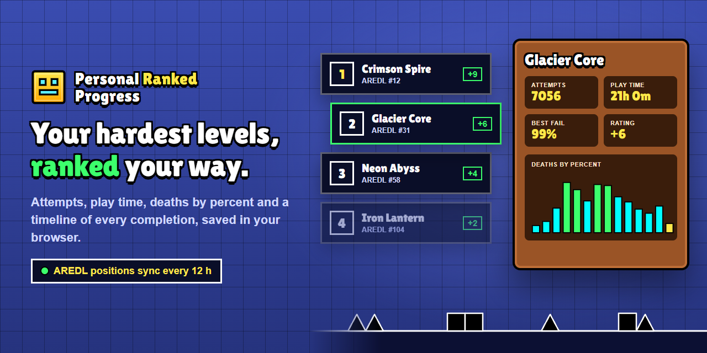
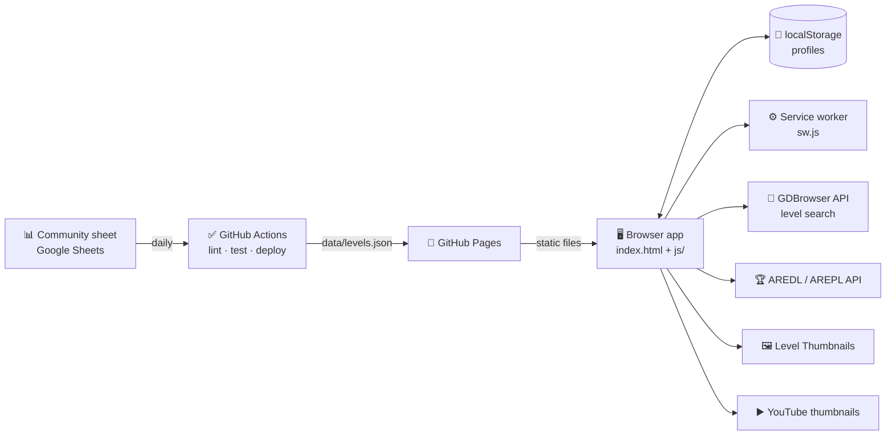

<p align="center">
  
</p>

<p align="center">
  <a href="https://github.com/Wal-014/Personal-Progress-List/actions/workflows/ci.yml"></a>
  <a href="https://github.com/Wal-014/Personal-Progress-List/actions/workflows/security.yml"></a>
  
  
  
</p>

<p align="center">
  <b>Track the hardest Geometry Dash levels you have beaten, in a list you rank yourself.</b><br>
  Attempts, play time, deaths by percent, ratings and a timeline of your completions, styled after the level editor and saved in your browser.
</p>

<p align="center">
  <a href="https://wal-014.github.io/Personal-Progress-List/">Live demo</a> ·
  <a href="https://github.com/Wal-014/Personal-Progress-List/issues">Report a bug</a> ·
  <a href="#running-locally">Run it locally</a>
</p>

> Personal project. Not affiliated with RobTop Games, Geometry Dash or the AREDL.

---

## What it does

- **Profiles** — each profile has its own lists, wishlists and tags, and a cube icon in a primary and a secondary colour of your choice; a menu at the top of Home switches between them and creates, edits, deletes, exports and imports them.
- **Your own ranking** — Classic and Platformer lists with drag-and-drop cards for your personal top (`#12 / 90`), the level's AREDL position, its thumbnail as the card background and its difficulty face.
- **Difficulty faces** — the game's face for each difficulty, from NA to Extreme Demon, with the Featured, Epic, Legendary or Mythic halo of its rating, on level cards, wishlist cards, search results and the level form. Sync looks up the rating of saved levels that do not have one yet.
- **Level details** — attempts (normal and copy), play time, completion date, YouTube video with its thumbnail, enjoyment and liking ratings from −10 to 10, tags, notes and a deaths-by-percent histogram.
- **Automatic AREDL sync** — AREDL positions, level IDs, creators and difficulties refresh when the app opens or regains focus if they are more than 12 hours old; a chip in the top bar shows the status and the pause menu has **Update now**.
- **Level search** — the level form and wishlists search [GDBrowser](https://gdbrowser.com) by name or ID, with Rated / Unrated, rate type and difficulty filters, and list the matches as cards with their thumbnail, most downloaded first. Picking one fills in the name, ID, creator, difficulty, rating and list, which cannot be edited by hand. When nothing matches, similar names from the AREDL and the community sheet are suggested.
- **Every rated level** — sync fills missing creators and difficulties from the Geometry Dash community sheet of rated levels, not only for levels on the AREDL.
- **Wishlists** — *Not started / In progress / Completed* states, a progress bar per list, and completed levels sent to your lists.
- **Statistics** — totals, per-mode level rankings by attempts, playtime or enjoyment, two-level comparisons, a zoomable attempts/playtime timeline, and completions by difficulty and by year.
- **Search, tags and notifications** — live name search that keeps the selected level, a tag filter that shows the levels with any of the chosen tags, colour tags that filter the list when clicked, and a bell that lists levels not yet placed in your ranking, completed wishlist levels not yet in a list, and levels without an ID.
- **Themes, languages and offline use** — Classic blue, Night and Synth themes, Spanish and English, and an installable PWA that opens without a connection.

## How it works



There is no backend and no account. Profiles live in the browser's `localStorage` and only leave it when you export one (**Export** in the profile menu on Home, or in the toolbar). To move a profile to another device, export it and use **Import profile** there; tabs open on the same device stay in sync. Level IDs do appear in the requests to the AREDL API, Level Thumbnails and YouTube, because those services look levels up by ID, and what you type in the level search is sent to GDBrowser. The browser never contacts Google: the deploy job downloads the community sheet (`scripts/build-levels.js`) and publishes a slim copy, `data/levels.json` (about 59,000 levels as `[id, name, creator, difficulty, platformer]`, roughly 1 MB compressed), which the app loads from the site only when it syncs, fills a wishlist or suggests names for a search that found nothing. The AREDL lists still provide the positions, which the sheet does not have. The level search uses GDBrowser rather than [GDHistory](https://history.geometrydash.eu/api/) because GDHistory sends no CORS headers, so a browser app cannot call it; GDBrowser returns the same level data. Thumbnails keep coming from Level Thumbnails, since neither service serves them.

The scripts are classic scripts, not ES modules, so the app also works by opening `index.html` directly from disk. That is why the load order in `index.html` matters: each file uses what the previous ones define (`config` → `i18n` → `utils` → `state` → `api` → `sheet` → `gd` → `components/` → `render` → `events` → `main`). User actions are wired through `data-act` attributes handled in `js/events.js`.

The service worker is network-first: it always tries the latest version and falls back to its cache offline. It only caches the app's own files, never API responses. The Lilita One font is self-hosted in `fonts/` (SIL OFL, see `fonts/OFL.txt`) and SortableJS 1.15.2 in `vendor/` (MIT, notice kept in the file), because the Content Security Policy only allows the app's own fonts and scripts. The difficulty faces are WebP copies of the game's sprites in `assets/faces/`, taken from GDBrowser and centred on one canvas so every halo lines up; serving them from the site keeps them working offline.

**Stack:** HTML · CSS · JavaScript (no framework, no build step) · SortableJS · GitHub Pages · GitHub Actions

## Running locally

Needs a modern browser and any static file server, for example Python 3. The checks need Node.js 24.

```bash
python -m http.server 8000    # then open http://localhost:8000

npm ci                        # install the dev tools (ESLint)
npm run lint                  # ESLint over the app, the service worker and the tests
npm test                      # unit tests with node:test (tests/)
npm run levels                # download the community sheet into data/levels.json (git-ignored)
```

On Windows, `iniciar.bat` starts the same server and opens the browser; on macOS and Linux, `iniciar.command` does the same with `python3`. There are no environment variables: the app has no backend and none of the external services needs an API key. The first visit loads the demo profile from `data/demo-data.js`, which contains fictional data. Without `data/levels.json` the app still works; it just cannot fill creators and difficulties from the sheet.

Node is only used for the checks; the app itself has no dependencies to install. `eslint.config.js` reads the script list in `index.html` so that names shared between the classic scripts count as defined and no local variable can hide one of them. `tests/load-scripts.js` runs the scripts a test needs in one shared `vm` context, the same way the page does, and `tests/globals.test.js` fails when two scripts declare the same top-level name or when one is never used.

The banner is drawn in `docs/brand/banner.html`. Regenerate it from the repository root with
`npx -y playwright@1.63.0 screenshot --viewport-size "1280,640" "file:///<absolute path>/docs/brand/banner.html" docs/brand/banner.png`. The favicon source is `docs/brand/favicon.svg`; render it to `favicon.png` at 64x64 with a transparent background, for example with Playwright's `page.screenshot({ omitBackground: true })`.

## Deployment

The `CI` workflow (`.github/workflows/ci.yml`) runs lint and tests on every pull request and on every push to `main`. On `main`, a second job deploys the repository root to GitHub Pages only after those checks pass, so a merge goes live at <https://wal-014.github.io/Personal-Progress-List/> only when CI is green. The only build step is `npm run levels`, which the deploy job runs to publish a fresh copy of the community sheet; a schedule also runs the workflow every day at 05:23 UTC for that reason. If the sheet cannot be downloaded or has far fewer levels than expected, the deploy fails and the previous version stays live. No secrets are needed. Dependabot (`.github/dependabot.yml`) proposes weekly updates for the npm dev tools and the pinned actions.

The `Security` workflow (`.github/workflows/security.yml`) runs on the same events with one job per scanner: gitleaks (secrets, including git history), semgrep (vulnerable code), osv-scanner (vulnerable dependencies in `package-lock.json`) and zizmor (unsafe workflow configuration).

First-time setup, done once by a repository admin:

1. **Settings → Pages → Build and deployment → Source:** choose **GitHub Actions**, so Pages stops publishing every push and waits for the CI deploy job.
2. **Settings → Branches:** protect `main`, require a pull request and require the **ci** status check (and the four **Security** jobs), so a failing PR cannot be merged.

## Security

- **No secrets** — there is no backend and no API key; nothing secret exists to leak.
- **Content Security Policy** — a `<meta>` policy in `index.html` sets `default-src 'self'`, allows scripts only from the app itself, network requests only to `api.aredl.net` and `gdbrowser.com`, images only from the thumbnail hosts, and sets `object-src 'none'`, `base-uri 'self'` and `form-action 'none'`. `style-src` allows `'unsafe-inline'` because the UI renders inline `style` attributes. A `<meta name="referrer">` tag sets `strict-origin-when-cross-origin`. `frame-ancestors` and `X-Content-Type-Options` need HTTP headers, which GitHub Pages does not let a site set; it does send HSTS on its own.
- **Output escaping** — user text such as level names, notes and links goes through `escapeHtml` (`js/utils.js`) before it is rendered.
- **Import validation** — imported profiles are checked by `isValidProfileData` (`js/state.js`) and rejected when they do not match the expected shape.
- **Personal data stays out of git** — `.gitignore` excludes `private/`, `*.profile.json` and `*-backup*.json`.
- **Locked-down pipeline** — every action is pinned to a commit SHA, the workflow token is read-only except for the Pages deploy job, and checkout does not keep credentials.
- **Few API requests** — a sync downloads the two AREDL lists once; creators come from the sheet copy instead of one AREDL request per level.

## License

All rights reserved. The code is published for viewing only; see [`LICENSE`](LICENSE).

Credits: level search, data and difficulty faces from [GDBrowser](https://gdbrowser.com), positions from the [All Rated Extreme Demons List](https://aredl.net) ([API](https://api.aredl.net/v2/docs)), IDs, creators and difficulties from the [Geometry Dash community sheet of rated levels](https://docs.google.com/spreadsheets/d/1BBx9X8IYBtr7dA5cWu_smM2XBkLZzCXy7TjeEWRgag0), level thumbnails from [Level Thumbnails](https://levelthumbs.prevter.me). Geometry Dash © RobTop Games.
