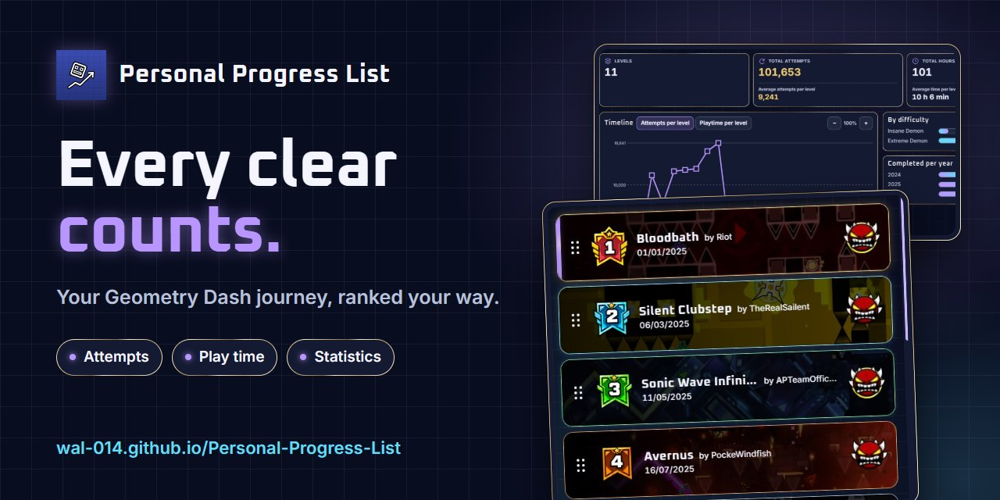
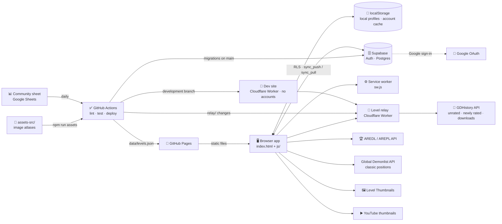

<p align="center">
  
</p>

<p align="center">
  <a href="https://github.com/Wal-014/Personal-Progress-List/actions/workflows/ci.yml"></a>
  <a href="https://github.com/Wal-014/Personal-Progress-List/actions/workflows/security.yml"></a>
  
  
  
</p>

<p align="center">
  <b>Track the hardest Geometry Dash levels you have beaten, in a list you rank yourself.</b><br>
  Attempts, play time, deaths by percent, ratings and a timeline of your completions, styled after the level editor. Use it on this device without an account, or sign in with Google to keep your progress on every device and share it by link.
</p>

<p align="center">
  <a href="https://wal-014.github.io/Personal-Progress-List/">Live demo</a> ·
  <a href="https://github.com/Wal-014/Personal-Progress-List/issues">Report a bug</a> ·
  <a href="#running-locally">Run it locally</a>
</p>

> Personal project. Not affiliated with RobTop Games, Geometry Dash or the AREDL.

---

## What it does

- **Accounts and sync** — sign in with Google and your lists, wishlists, tags, notes and preferences follow you to every device. Edits made offline wait on the device and are sent when the connection returns; when two devices change the same level, fields edited on only one side are both kept and the app names what changed. Your account has a display name, a username, a cube icon in two colours, a biography and a country.
- **No account needed** — without signing in, the app keeps your profile in this browser, as before. **Local data** in the profile menu lists every profile stored on the device, downloads backups, imports old backup files, switches between them and brings one into your account without overwriting anything there.
- **Public profiles** — profiles are private until you make yours public from **Share profile**; then anyone with its link (`?user=<username>`) sees your lists, statistics, wishlists and tags read-only, never your notes or email.
- **Your own ranking** — Classic and Platformer lists with drag-and-drop cards for your personal top (`#12 / 90`), the level's AREDL position, its thumbnail as the card background and the game's difficulty face, from NA to Extreme Demon, with the Featured, Epic, Legendary or Mythic halo of its rating. The faces also appear on wishlist cards, search results and the level form.
- **Level details** — attempts (normal and copy), play time, completion date, YouTube video with its thumbnail, enjoyment and liking ratings from −10 to 10, tags, notes and a deaths-by-percent histogram.
- **Automatic sync** — AREDL positions, level IDs, creators and difficulties refresh when the app opens or regains focus if they are more than 12 hours old. Missing creators, difficulties and rating tiers of any rated level, not only those on the AREDL, come from the Geometry Dash community sheet; the level relay (GDHistory) is asked only for tiers the sheet does not have. A chip beside the centred header shows the status and **Settings** has **Update now**.
- **Level search** — the level form and wishlists search by ID or by any part of a level's name as you type, with Rated / Unrated, rate type and difficulty filters. Every rated level comes from the community sheet; [GDHistory](https://history.geometrydash.eu), through the project's level relay, adds unrated levels, levels rated since the last sheet update and download counts. Results are cards with their thumbnail, best matches first, and picking one fills in the name, ID, creator, difficulty, rating and list. When nothing matches, similar names are suggested; when the relay does not answer, the search says what it could not cover ([why a relay and not GDBrowser](docs/level-data-providers.md)).
- **Wishlists** — *Not started / In progress / Completed* states, a progress bar per list, and completed levels sent to your lists.
- **Statistics** — totals, per-mode level rankings by attempts, playtime or enjoyment, two-level comparisons, a zoomable attempts/playtime timeline, and completions by difficulty and by year.
- **Filters, notifications and themes** — live name search that keeps the selected level, a tag filter that shows the levels with any of the chosen tags, and colour tags that filter the list when clicked; a bell lists levels not yet placed in your ranking, completed wishlist levels not yet in a list, and levels without an ID. Six colour themes (Nebula, Graphite, Ocean, Amber, Crimson and Porcelain) and four independent backgrounds (Grid, Aurora, Celestial and Orbital), Spanish and English, and an installable PWA that opens without a connection.

## How it works

Every screen shares a fixed sidebar and a centred Personal Progress List header. Below 1280px the sidebar opens as a keyboard-accessible drawer. The profile menu contains account or local-profile actions and tag management; page title rows contain the primary creation actions. Public profiles use the same navigation without editing controls.



Accounts live in [Supabase](https://supabase.com): Auth for Google sign-in and Postgres for the data, one row per level, wishlist item, tag and setting, with Row Level Security on every table so each account can only read and write its own rows, and anyone can read the public parts of a profile its owner made public. The browser talks to it with the publishable key in `js/config.js`, which is public by design; the Supabase client (`vendor/supabase.js`, supabase-js 2.119.0) is loaded only when an account feature is used. Every save writes a per-account cache in `localStorage` first and then sends only the changed rows, with the version each one had, to `sync_push`; the server stamps new versions, reports conflicts and refuses writes past each account's row caps and write budget. The cache is also what the app shows first on the next visit, so it opens instantly and works offline. [docs/cloud-accounts.md](docs/cloud-accounts.md) describes the schema, the access rules, the sync protocol, the migration of local profiles and operations; [docs/threat-models/2026-11-11-supabase-accounts.md](docs/threat-models/2026-11-11-supabase-accounts.md) lists the threats and their tests.

Without an account, profiles live in the browser's `localStorage` and only leave it when you download a backup from **Local data**; tabs open on the same device stay in sync. Level IDs appear in the requests to Level Thumbnails, which looks thumbnails up by ID, and to the level relay, which receives search text and, during sync, the IDs of saved levels whose rating tier is still unknown, and passes them on to GDHistory. The relay stores nothing; Cloudflare keeps its request logs for a few days. YouTube receives only the video ID of a saved video link, the AREDL API only the requests for its two full lists, and Global Demonlist only a request for its full classic list. The browser never contacts Google: the deploy job downloads the community sheet (`scripts/build-levels.js`) and publishes a slim copy, `data/levels.json` (about 59,000 levels as `[id, name, creator, difficulty index or -1, platformer, rating tier index or -1]`, roughly 1 MB compressed). The app loads it from the site for searches, sync and wishlist enrichment; cached five-field copies still work with an unknown tier. A level found in both sources keeps GDHistory's values and takes from the sheet only what GDHistory does not know, such as a creator it shows as "-". After a relay failure the app sends it no request for five minutes; a search that lost the relay carries on with the sheet alone, and the next search after those five minutes tries it again. The AREDL lists provide AREDL/AREPL positions, and Global Demonlist provides classic positions by Geometry Dash ID. Both sync independently on the same 12-hour schedule; a failed provider preserves its saved positions. [GDHistory](https://history.geometrydash.eu/api/) sends no CORS headers, so a browser app cannot call it directly; the relay in [`relay/`](relay/README.md), a Cloudflare Worker, calls it and answers only the site's origin. The app no longer uses GDBrowser for level data because it has put its API behind a Cloudflare challenge more than once, and getting around that would defeat its purpose. [docs/level-data-providers.md](docs/level-data-providers.md) compares every provider considered. Thumbnails keep coming from Level Thumbnails, since neither service serves them.

The scripts are classic scripts, not ES modules, so the app also works by opening `index.html` directly from disk. That is why the load order in `index.html` matters: each file uses what the previous ones define (`config` → `i18n` → `utils` → `state` → `api` → `sheet` → `relay` → `gd` → `cloud` → `account` → `cloud-model` → `sync` → `public-view` → `local-migration` → `components/` → `render` → `events` → `main`). User actions are wired through `data-act` attributes handled in `js/events.js`.

The service worker serves images under `assets/` cache-first. The build adds a hash of every published file except the worker and `data/` to the cache name, so any code, style or image release installs a new worker while the daily data refresh does not. Open tabs look for a new worker when they come back into view, when the connection returns and every 30 minutes; a tab with nothing to lose reloads once, and one with an open dialog, an edited level or account changes still uploading shows an update notice instead. Activation deletes only the app's own older caches. Other app files are network-first and fall back to the cache offline. It only caches the app's own files, never API responses. The app uses self-hosted Inter for controls and body text and Oxanium for headings and display values. Their SIL OFL licences are in `fonts/`. Shared appearance scales and palettes live in `css/tokens.css`; see [design tokens](docs/design-tokens.md). SortableJS 1.15.2 and supabase-js 2.119.0 are self-hosted in `vendor/` (MIT, notices kept in the files), because the Content Security Policy only allows the app's own fonts and scripts. The difficulty faces in `assets/faces/` are generated from `assets-src/faces.webp`, a WebP atlas of the game's sprites taken from GDBrowser and centred on one canvas so every halo lines up. Serving them from the site keeps them working offline.

**Stack:** HTML · CSS · JavaScript (no framework) · SortableJS · Supabase (Auth, Postgres 17, supabase-js) · GitHub Pages · GitHub Actions

## Running locally

Needs Node.js 24 to generate the cube, face and flag images and run the checks, plus a modern browser and a static file server such as Python 3.

When serving the repository directly, the service worker is unstamped, so use a hard reload or bump `CACHE` after editing an image.

```bash
npm ci                        # install the asset and check tools
npm run assets                # generate the cube, face and flag images (git-ignored output)
python -m http.server 8000    # then open http://localhost:8000

npm run lint                  # ESLint over the app, the service worker and the tests
npm test                      # unit tests with node:test (tests/)
npm run levels                # download the community sheet into data/levels.json (git-ignored)
npm run site                  # copy the files the site serves into _site/ (git-ignored), as the deploy does
npm run site -- development   # the same for the dev site: accounts off, Supabase out of the CSP, _site/_headers

# Accounts against a local Supabase stack (needs Docker)
npx supabase@2.122.0 start    # applies supabase/migrations and supabase/config.toml
npm run test:db               # database tests in tests/db/: RLS, constraints, limits, sync, public profiles
npx supabase@2.122.0 db reset # rebuild the local database from the migrations
```

The app always talks to the hosted project in `js/config.js`. To try accounts against the local stack, route requests to `https://mjgklvdnuhbnyucytaji.supabase.co` to `http://127.0.0.1:54321` and use the local publishable key, as the browser tests in [docs/cloud-accounts.md](docs/cloud-accounts.md#development) do. Google sign-in only works against the hosted project.

On Windows, `iniciar.bat` starts the same server and opens the browser. On macOS and Linux, `iniciar.command` does the same with `python3`. Both scripts install dependencies if needed and regenerate the cube, face and flag images before starting the server. The app reads no environment variables: the Supabase URL and publishable key in `js/config.js` are public, and none of the other services needs an API key. Maintainers who push `supabase/config.toml` to the hosted project with `npx supabase@2.122.0 config push` need these in their own environment, never in the repository:

| Variable | Description |
|---|---|
| `SUPABASE_ACCESS_TOKEN` | A Supabase personal access token (Account → Access Tokens) with access to the project. |
| `SUPABASE_AUTH_EXTERNAL_GOOGLE_CLIENT_ID` | The Google OAuth client ID from the project's Google Cloud console. |
| `SUPABASE_AUTH_EXTERNAL_GOOGLE_SECRET` | The secret of that Google OAuth client. |

The first visit starts an empty profile. The fictional demo profile used by tests and the card screenshots is `tests/fixtures/demo-profile.js`. Without `data/levels.json` the app still works; it just cannot fill creators and difficulties from the sheet.

`eslint.config.js` reads the script list in `index.html` so that names shared between the classic scripts count as defined and no local variable can hide one of them. `tests/load-scripts.js` runs the scripts a test needs in one shared `vm` context, the same way the page does, and `tests/globals.test.js` fails when two scripts declare the same top-level name or when one is never used.

The banner is drawn in `docs/brand/banner.html` and the promotional card, also the site's link preview image, in `docs/brand/card.html`. Both share `docs/brand/brand.css` (the app's Nebula palette, metallic rims and its Oxanium and Inter fonts) and the app screenshots in `docs/brand/card/` (demo profile, English, Nebula theme, 1440x900, after the AREDL sync). With a server at the repository root (`python -m http.server 8000 --bind 127.0.0.1`, so the fonts load), regenerate them with
`npx -y playwright@1.63.0 screenshot --viewport-size "1280,640" "http://localhost:8000/docs/brand/banner.html" docs/brand/banner.jpg` and
`npx -y playwright@1.63.0 screenshot --viewport-size "1200,630" "http://localhost:8000/docs/brand/card.html" docs/brand/card-2.jpg`. Chat apps cache link previews by URL, so a redesigned card gets a new file name, written in `og:image` in `index.html` and in `SITE_FILES` in `scripts/build-site.js`. Retake the screenshots when the screens they show change. The favicon source is `docs/brand/favicon.svg`; render it to `favicon.png` at 64x64 with a transparent background, for example with Playwright's `page.screenshot({ omitBackground: true })`.

`npm run assets` cuts the atlases `assets-src/cubes.webp` and `assets-src/faces.webp` into `assets/cubes/` and `assets/faces/`. The face atlas is lossless, and the generated faces use lossy WebP to keep downloads small. The command also generates 64×48 WebP country flags in `assets/flags/` from the pinned `flag-icons` npm package and copies the package licence alongside them. `scripts/build-cubes.py` rebuilds the cube atlas from the GDBrowser Icon Kit using Pillow and requests.

## Deployment

Work reaches production in two steps. Pull requests target the `development` branch; merging one deploys the dev site, <https://ppl-dev.waquermaster.workers.dev/>, where the change can be checked running. When `development` looks right, a release pull request from `development` to `main` ships it to production. An urgent fix may target `main` directly, and `main` is then merged back into `development`. `main` stays the default branch because scheduled workflows run there.

The dev site is an assets-only Cloudflare Worker (`dev-site/wrangler.jsonc`) on the same account as the relay. It is built from the same files with `npm run site -- development`, which turns accounts off (`ACCOUNTS` in `js/config.js`) and removes the Supabase project from its Content Security Policy, because there is no dev database: it can never read or write production accounts. Its responses carry `X-Robots-Tag: noindex`, so search engines leave it out; the address is not secret, only unlisted. It uses the production relay, which allows its origin. Account and database changes are tested by the `db` job and on the local Supabase stack instead.

The `CI` workflow (`.github/workflows/ci.yml`) runs lint and tests on every pull request and on every push to `main` and `development`. On `development`, the `deploy-dev` job then builds the dev site and deploys it with Wrangler from the relay's lockfile and the `development` environment's `CLOUDFLARE_API_TOKEN` secret; if the community sheet is unavailable it deploys production's copy of `data/levels.json`. On `main`, a second job deploys the site to GitHub Pages only after those checks pass, so a merge goes live at <https://wal-014.github.io/Personal-Progress-List/> only when CI is green. Both deploy jobs generate the cube, face and flag images with `npm run assets` before packaging the site. `npm run levels` publishes a fresh copy of the community sheet, and the workflow runs every day at 05:23 UTC to refresh it. The daily run skips `ci` and `db` because the commit already passed them when it was pushed. `npm run site` (`scripts/build-site.js`) then copies only the files the site serves into `_site/`, the folder that is published, so source atlases, tests, docs and tooling stay off the live site; `tests/site.test.js` fails if the page, the service worker or a script needs a file outside that list. If the sheet cannot be downloaded or has far fewer levels than expected, a push to `main` still deploys with the `data/levels.json` that is live, under a warning on the run, so a sheet outage does not hold back code changes; the scheduled and manual runs fail instead and the previous version stays live. A `db` job starts a local Supabase stack and runs the database tests; the deploy waits for it too. Database migrations reach the hosted project only from `main`: the `migrate-prod` job reads `SUPABASE_DB_URL` from the `production-database` environment and runs `supabase db push` before the Pages deploy, so the site never meets a schema older than it expects. The daily run still waits for `migrate-prod`, which retries any pending migration that failed on a push and changes nothing when none are pending. Migrations therefore have to work with the version of the site that is live until the deploy finishes. The level relay deploys on its own: the `Relay` workflow (`.github/workflows/relay.yml`) runs the tests and deploys the Worker to Cloudflare when a push to `main` changes `relay/`, with the `cloudflare-relay` environment's `CLOUDFLARE_API_TOKEN` secret ([relay/README.md](relay/README.md)). Dependabot (`.github/dependabot.yml`) proposes weekly updates for the npm dev tools, the relay's Wrangler and the pinned actions, against `development`.

The Settings footer shows `v1.1.0` on GitHub Pages. The `deploy` job sets `PRODUCTION_RELEASE=true` and the production build uses `RELEASE_LINE` in `scripts/build-site.js`. Bump this value in subsequent release PRs according to SemVer. Local and development builds show `v0.1.0-dev`.

The `Security` workflow (`.github/workflows/security.yml`) runs on every pull request and every push to `main`, but not on the daily schedule, with one job per scanner: gitleaks (secrets, including git history), semgrep (vulnerable code), osv-scanner (vulnerable dependencies in `package-lock.json`) and zizmor (unsafe workflow configuration).

The `Backup` workflow (`.github/workflows/backup.yml`) dumps the hosted database every Monday at 05:17 UTC, and on demand from the Actions tab. It encrypts the dump with [age](https://age-encryption.org) for the public keys in `supabase/backup-recipients.txt` and keeps only the encrypted file as a 90-day artifact. Its one secret, `SUPABASE_DB_URL`, lives in the `production-database` environment and holds the session pooler connection string with the database password. Restoring, rollback and monitoring are in [docs/cloud-accounts.md](docs/cloud-accounts.md#operations).

First-time setup, done once by a repository admin:

1. **Settings → Pages → Build and deployment → Source:** choose **GitHub Actions**, so Pages stops publishing every push and waits for the CI deploy job.
2. In **Settings → Environments**, limit each environment to one branch under **Deployment branches**. Both `development` (branch `development`) and `cloudflare-relay` (branch `main`) hold `CLOUDFLARE_API_TOKEN` ([how to create it](relay/README.md#deploy-a-change)). The `production-database` environment (branch `main`) holds `SUPABASE_DB_URL`. The repository keeps no Actions secrets of its own.
3. **Settings → Rules → Rulesets:** add a ruleset for `main` and `development` that requires a pull request and the **ci**, **db**, **gitleaks**, **semgrep**, **osv-scanner** and **zizmor** status checks, and blocks deletions and force pushes, so a failing PR cannot be merged.

## Security

- **No secrets in the app** — the site only holds Supabase's publishable key, which is public by design; secret and service-role keys are never used by the app or stored in the repository, and `tests/secrets.test.js` fails if one appears. The database connection string for backups and production migrations and the Cloudflare token used to deploy the relay and the dev site (scoped to editing Workers) live in GitHub environment secrets, with each environment limited to the branch that deploys from it. `tests/dev-environment.test.js` checks that the CI jobs that read them never run for pull requests and that every job that reads a deploy secret runs in an environment.
- **Row Level Security** — every table has RLS with owner-only policies; public profiles add read-only policies, and notes and settings never get one. `tests/db/` proves that one account cannot read or change another's rows and that anonymous visitors cannot write anything.
- **Server-side limits** — check constraints validate every column, per-account row caps and a write budget (HTTP 429) stop runaway writes, versions and timestamps are stamped by the server, and deleted rows are archived for 30 days.
- **Google-only sign-in for now** — email and password sign-in is built but switched off (`EMAIL_AUTH` in `js/config.js`) and the hosted email provider is disabled until an email provider is set up.
- **Level relay** — the Worker in `relay/` sends CORS headers only to `https://wal-014.github.io` and the dev site, answers 403 to any other origin, rejects every parameter outside its allowlist with a 400, limits each IP to about 30 requests per 10 seconds, and sends its own Content Security Policy, HSTS, `nosniff` and `no-referrer` headers ([relay/README.md](relay/README.md)).
- **Content Security Policy** — a `<meta>` policy in `index.html` sets `default-src 'self'`, allows scripts only from the app itself, network requests only to `api.aredl.net`, the level relay and the Supabase project, images only from the thumbnail hosts, and sets `object-src 'none'`, `base-uri 'self'` and `form-action 'none'`. `style-src` allows `'unsafe-inline'` because the UI renders inline `style` attributes. A `<meta name="referrer">` tag sets `strict-origin-when-cross-origin`. `frame-ancestors` and `X-Content-Type-Options` need HTTP headers, which GitHub Pages does not let a site set; it does send HSTS on its own. The dev site can set headers, so its `_site/_headers` adds `frame-ancestors 'none'`, `nosniff`, HSTS and the referrer policy.
- **Output escaping** — user text such as level names, notes and links goes through `escapeHtml` (`js/utils.js`) before it is rendered; public profiles render someone else's text, and `tests/public-view.test.js` renders one made of script payloads on every screen.
- **Import validation** — imported backups are checked by `isValidProfileData` (`js/state.js`) and rejected when they do not match the expected shape; profiles brought into an account are cleaned to the database limits first.
- **Personal data stays out of git** — `.gitignore` excludes `private/`, `*.profile.json` and `*-backup*.json`.
- **Locked-down pipeline** — every action is pinned to a commit SHA, the workflow token is read-only except for the Pages deploy job, and checkout does not keep credentials. Backups are encrypted before they leave the runner and the password is masked in the logs.
- **Few API requests** — a sync downloads the two AREDL lists once; creators come from the sheet copy instead of one AREDL request per level.

## Repository language

Write issues, pull requests, commit messages, change explanations and documentation in English. Capture previews with the interface set to English and use English sample content, captions and filenames. The application supports English and Spanish.

## License

All rights reserved. The code is published for viewing only; see [`LICENSE`](LICENSE).

Credits: level search and data from [GDHistory](https://history.geometrydash.eu), difficulty faces from [GDBrowser](https://gdbrowser.com), positions from the [All Rated Extreme Demons List](https://aredl.net) ([API](https://api.aredl.net/v2/docs)), IDs, creators and difficulties from the [Geometry Dash community sheet of rated levels](https://docs.google.com/spreadsheets/d/1BBx9X8IYBtr7dA5cWu_smM2XBkLZzCXy7TjeEWRgag0), level thumbnails from [Level Thumbnails](https://levelthumbs.prevter.me). Geometry Dash © RobTop Games.
