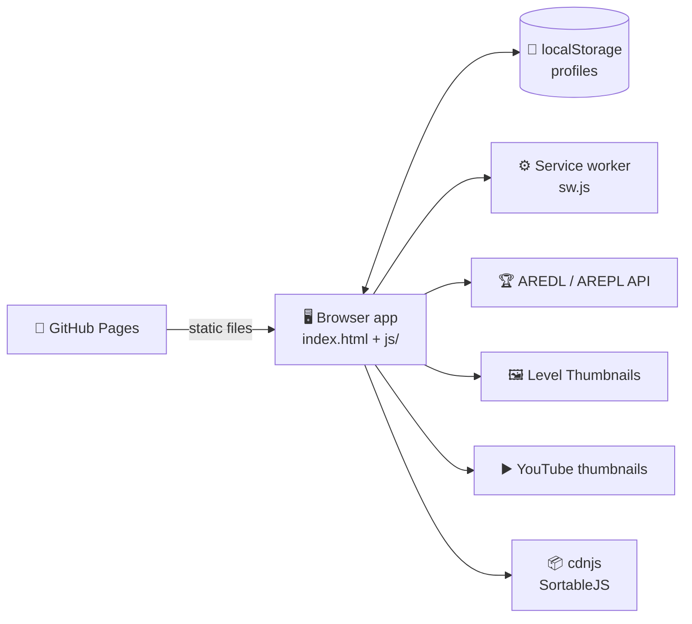

<p align="center">
  
</p>

<p align="center">
  <a href="https://github.com/Wal-014/Personal-Progress-List/actions/workflows/pages/pages-build-deployment"></a>
  
  
  
</p>

<p align="center">
  <b>Track the hardest Geometry Dash levels you have beaten, in a list you rank yourself.</b><br>
  Attempts, play time, deaths by percent, ratings and a timeline of your completions, styled after the level editor and saved in your browser.
</p>

<p align="center">
  <a href="https://wal-014.github.io/Personal-Progress-List/">Live demo</a> ·
  <a href="https://github.com/Wal-014/Personal-Progress-List/issues">Report a bug</a> ·
  <a href="#running-locally">Run it locally</a>
</p>

> Personal project. Not affiliated with RobTop Games, Geometry Dash or the AREDL.

---

## What it does

- **Profiles** — each profile has its own lists, wishlists and tags; create, rename, delete, export and import them.
- **Your own ranking** — Classic and Platformer lists with drag-and-drop cards for your personal top (`#12 / 90`), the level's AREDL position and its thumbnail as the card background.
- **Level details** — attempts (normal and copy), play time, completion date, YouTube video with its thumbnail, enjoyment and liking ratings from −10 to 10, tags, notes and a deaths-by-percent histogram.
- **Automatic AREDL sync** — positions, IDs and publishers refresh when the app opens or regains focus if they are more than 12 hours old; a chip in the top bar shows the status and the pause menu has **Update now**.
- **Wishlists** — *Not started / In progress / Completed* states, a progress bar per list, and completed levels sent to your lists.
- **Statistics** — totals, a zoomable attempts timeline, and completions by difficulty and by year.
- **Search, tags and notifications** — live search that keeps the selected level, colour tags, and a bell that lists levels not yet placed in your ranking, completed wishlist levels not yet in a list, and levels without an ID.
- **Themes, languages and offline use** — Classic blue, Night and Synth themes, Spanish and English, and an installable PWA that opens without a connection.

## How it works



There is no backend and no account. Profiles live in the browser's `localStorage` and only leave it when you export one (the download button on its card on Home, or **Export** in the toolbar). To move a profile to another device, export it and use **Import profile** there; tabs open on the same device stay in sync. Level IDs do appear in the requests to the AREDL API, Level Thumbnails and YouTube, because those services look levels up by ID.

The scripts are classic scripts, not ES modules, so the app also works by opening `index.html` directly from disk. That is why the load order in `index.html` matters: each file uses what the previous ones define (`config` → `i18n` → `utils` → `state` → `api` → `components/` → `render` → `events` → `main`). User actions are wired through `data-act` attributes handled in `js/events.js`.

The service worker is network-first: it always tries the latest version and falls back to its cache offline. It only caches the app's own files, never API responses. The Lilita One font is self-hosted in `fonts/` (SIL OFL, see `fonts/OFL.txt`) because the Content Security Policy blocks external fonts.

**Stack:** HTML · CSS · JavaScript (no framework, no build step) · SortableJS · GitHub Pages

## Running locally

Needs a modern browser and any static file server, for example Python 3.

```bash
python -m http.server 8000    # then open http://localhost:8000
```

On Windows, `iniciar.bat` starts the same server and opens the browser; on macOS and Linux, `iniciar.command` does the same with `python3`. There are no environment variables: the app has no backend and none of the external services needs an API key. The first visit loads the demo profile from `data/demo-data.js`, which contains fictional data.

The banner is drawn in `docs/brand/banner.html`. Regenerate it from the repository root with
`npx -y playwright@1.63.0 screenshot --viewport-size "1280,640" "file:///<absolute path>/docs/brand/banner.html" docs/brand/banner.png`.

## Deployment

GitHub Pages serves the repository root from `main`, so every merge to `main` goes live at <https://wal-014.github.io/Personal-Progress-List/>. There is no build step and no secrets are needed; `.nojekyll` makes Pages serve the files as they are.

## Security

- **No secrets** — there is no backend and no API key; nothing secret exists to leak.
- **Content Security Policy** — a `<meta>` policy in `index.html` sets `default-src 'self'`, allows scripts only from the app and `cdnjs.cloudflare.com`, network requests only to `api.aredl.net`, images only from the thumbnail hosts, and sets `object-src 'none'`, `base-uri 'self'` and `form-action 'none'`. `style-src` allows `'unsafe-inline'` because the UI renders inline `style` attributes. Headers such as `frame-ancestors` and HSTS cannot be set from a `<meta>` tag on GitHub Pages.
- **Subresource Integrity** — SortableJS is loaded from cdnjs with an `integrity` hash.
- **Output escaping** — user text such as level names, notes and links goes through `escapeHtml` (`js/utils.js`) before it is rendered.
- **Import validation** — imported profiles are checked by `isValidProfileData` (`js/state.js`) and rejected when they do not match the expected shape.
- **Personal data stays out of git** — `.gitignore` excludes `private/`, `*.profile.json` and `*-backup*.json`.
- **Polite API use** — requests to the AREDL API back off and retry when it answers `429 Too Many Requests`.

## License

All rights reserved. The code is published for viewing only; see [`LICENSE`](LICENSE).

Credits: positions and publishers from the [All Rated Extreme Demons List](https://aredl.net) ([API](https://api.aredl.net/v2/docs)), level thumbnails from [Level Thumbnails](https://levelthumbs.prevter.me). Geometry Dash © RobTop Games.
