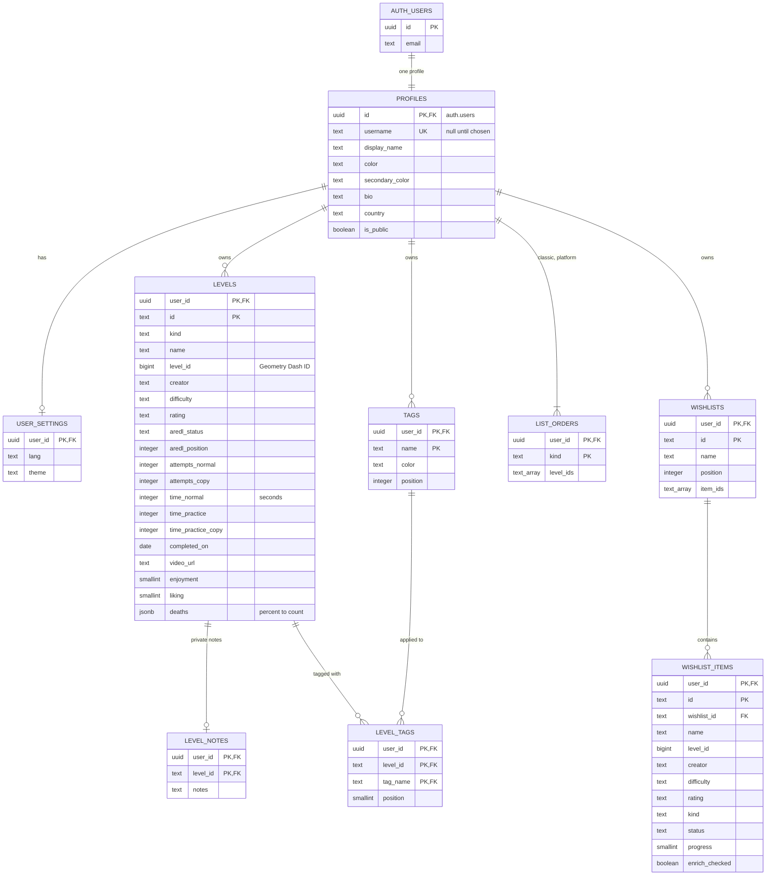

# Cloud accounts

How Personal Ranked Progress moves from profiles kept in the browser to Supabase accounts (#192). This document records the design that issues #193-#198 implement; the security analysis is in [threat-models/2026-11-11-supabase-accounts.md](threat-models/2026-11-11-supabase-accounts.md).

## Decisions

| Question (issue) | Decision |
|---|---|
| Can the app keep running on GitHub Pages without a backend of its own? (#192, #193) | Yes. The page talks to Supabase directly with the publishable key; Row Level Security in Postgres is the authorization boundary. No server or Edge Function is needed. |
| Framework or rewrite? (#193) | Neither. The Supabase JavaScript client is vendored as a classic script (`vendor/supabase.js`, the UMD build of `@supabase/supabase-js`), like SortableJS, so the CSP keeps `script-src 'self'`. It is loaded only when an account is in use. |
| Normalized tables or JSON? (#195) | Relational tables, one row per level, wishlist, wishlist entry and tag, with typed and checked columns. Deaths per percent stay a JSON object on the level, because they are a sparse map read as a whole. |
| How is manual ordering stored? (#195) | Each ranked list (Classic, Platformer) and each wishlist keeps its order as one array of IDs, so a reorder is a single row write and two devices reordering at once cannot interleave into duplicate positions. Wishlists and tags, which have no manual order, keep a `position`. |
| Which statistics are stored? (#195) | Only the raw values the forms collect (attempts, times, deaths, dates, ratings). Totals, rankings, comparisons and the timeline stay computed in the browser, as today. |
| Real-time sync or on load and save? (#195) | On load and save, plus a check when the tab becomes visible again and when the connection comes back. Realtime subscriptions are not needed for one person's devices. |
| How are simultaneous edits resolved? (#195) | Every row has a version assigned by the server. A save only applies when the version the device last saw is still current; otherwise the device merges field by field. If both devices changed the same field, the newer saved value wins and the app names the entries that changed elsewhere. |
| Offline use? (#195) | The app keeps working offline: changes are saved on the device and sent when the connection returns, through the same versioned saves. The status in the top bar says whether changes are saved, waiting or failed; nothing is reported as saved before the server confirms it. |
| Which preferences sync? (#195) | Language and theme sync with the account. Timeline zoom, the open tab and filters stay on the device. |
| Is an account required? (#196) | No. Without signing in, the app keeps one profile on this device, as it does today. Signing in syncs it. |
| Several local profiles? (#196) | When someone signs in for the first time on a device that has local profiles, they pick the one that becomes their account's data, see what will be copied and confirm. Nothing is merged automatically. The local profiles stay on the device as a backup that can be downloaded until the user deletes it. |
| What if the account already has data? (#196) | The app says so and asks before adding the local levels to it; it never overwrites cloud data. |
| Mandatory account fields? (#194) | Only a display name. The username is chosen later and is required only to share a public profile. Biography and country are optional; the country is picked from a list of ISO country codes. |
| Linking Google and email sign-in? (#194) | Supabase links identities that share a verified email address, so one person keeps one account and one profile. |
| Public by default? (#197) | No. Profiles are private until their owner makes them public, which also requires a username. |
| What is public? (#197) | Display name, icon colours, biography, country, both ranked lists with their statistics, wishlists and tags. Personal notes are never public. |
| Public profile URL? (#197) | `https://wal-014.github.io/Personal-Progress-List/?user=<username>`. Changing a username breaks old links; the editor warns about it. |
| Does it fit the free plan? (#192, #193) | Yes for a community of this size, see [Platform limits](#platform-limits). |

## Database

All tables live in the `public` schema, which the Data API exposes, and every one of them has Row Level Security. Helper functions and the internal counters live in a `private` schema that the API does not expose. Each user's rows are keyed by `(user_id, id)`: IDs are the ones the app already generates, so they only need to be unique per account and move unchanged from local storage.

Every data table also has `version`, `created_at` and `updated_at`, left out of the diagram. Primary keys start with `user_id`, so every query of one account's rows uses the primary key index.



| Table | Rows |
|---|---|
| `profiles` | One per account, created by a trigger when the account is created. |
| `user_settings` | At most one per account. |
| `levels` | One per saved level. |
| `level_notes` | One per level that has notes. |
| `tags` | One per tag. |
| `level_tags` | One per tag on a level. Renaming a tag cascades to these rows, and deleting a tag or a level removes them. |
| `list_orders` | One per ranked list. |
| `wishlists` | One per wishlist. |
| `wishlist_items` | One per wishlist entry. |

Every foreign key is `on delete cascade`: deleting a level removes its notes and tags, deleting a wishlist removes its entries, and deleting the account removes everything. The foreign keys from `level_tags` and `wishlist_items` are deferrable, so one sync batch can write a child before its parent.

How the app's fields map to columns:

| App field | Column | Notes |
|---|---|---|
| level `levelId`, `diff`, `ar.s`, `ar.p` | `level_id`, `difficulty`, `aredl_status`, `aredl_position` | The name, ID, creator, difficulty, rating and AREDL fields are metadata the app looks up from GDHistory, the AREDL and the community sheet; they stay on the user's row because they are a per-user cache that the app refreshes itself, not data users may write for everyone. |
| level `attN`, `attC`, `tN`, `tP`, `tPC` | `attempts_normal`, `attempts_copy`, `time_normal`, `time_practice`, `time_practice_copy` | Times are seconds. |
| level `date`, `link`, `enj`, `lik` | `completed_on` (date), `video_url`, `enjoyment`, `liking` | |
| level `notes` | `level_notes.notes` | A separate table so public profiles can be served by RLS without ever exposing notes. |
| level `tags` | `level_tags` rows, `position` = index in the array | A tag is identified by its name, as in the app. |
| `order.classic`, `order.platform` | `list_orders.level_ids` | |
| wishlist `items` order | `wishlists.item_ids` | |
| wishlist item `pct`, `chk` | `progress`, `enrich_checked` | |

Every column has a check constraint:

- allowed values for `kind`, `difficulty`, `rating`, `status`, `aredl_status`, `lang` and `theme`, written as `check (… in (…))` rather than enum types, so a new value is a one-line migration;
- `#rrggbb` colours, `http(s)` video links, positive Geometry Dash level IDs, and IDs in the order arrays matching the app's ID format;
- lengths: names and creators 100, notes 5,000, display names 40, biographies 300, tag names 40;
- ranges: attempts and seconds 0-1,000,000,000, enjoyment and liking -10 to 10, wishlist progress 0-100, tag position on a level 0-49;
- deaths as an object of percentages 0-100 with whole, non-negative counts;
- usernames `^[a-z0-9_]{3,20}$`, unique, and countries as two capital letters.

Triggers on every table assign `version` (1 on insert, +1 on each update), `created_at` and `updated_at`, whatever the client sends. Statement triggers enforce:

- per-account row caps: 5,000 levels, 50,000 level tags, 200 wishlists, 5,000 wishlist entries and 300 tags;
- a write budget of 50,000 written rows per minute per account.

Both apply to every way of writing, not only to the app's own requests. Deletes are not charged, so an account can always be deleted.

### Design choices

The schema is in third normal form except where noted below.

- **Ranked order as one array per list** (`list_orders.level_ids`, `wishlists.item_ids`). The ranking is a single value that the app edits as a whole. Storing it in one row makes a reorder one atomic write, and lets the version check reject a stale reorder whole. A rank column on every level would turn two devices reordering at the same time into a mix of both orders with duplicate positions. The cost is that an array element is not a foreign key: an ID left behind by a deleted level is ignored by the app, exactly as it is today, and the next save drops it.
- **Deaths as JSON** (`levels.deaths`). A sparse map of at most 101 percentages that is always read and written whole, for one chart. A row per percentage would multiply the rows by up to 100 with nothing gained. A check function validates its shape.
- **Geometry Dash metadata on each user's rows** (name, ID, creator, difficulty, rating and AREDL status on `levels` and `wishlist_items`). The app looks these up from GDHistory, the AREDL and the community sheet. A shared table of levels that every account could write would let one account change the data shown to everyone. A per-user cache keeps each account's data isolated.
- **Notes in their own table** (`level_notes`). It is a one-to-one split, not a denormalization: public profiles (#197) are served by RLS on whole rows, and notes must never be public.
- **No `updated_by` column.** RLS lets only the owner write their rows, so the author of every change is `user_id`. Administrative changes go through versioned migrations in Git.

### Data handling

- `null` means unknown or not recorded (attempts, times, dates, ratings). Collections are never null: an empty order array is `{}` and empty deaths are `{}`.
- Statuses are closed lists checked by the database: wishlist entries are `todo`, `prog` or `done`, and AREDL status is `r`, `n` or `p`.
- **Deletion is physical, with an archive.** Rows are deleted, not flagged, so every query, policy and row cap sees only live data. An AFTER DELETE trigger copies each deleted row of `levels`, `level_notes`, `level_tags`, `list_orders`, `wishlists`, `wishlist_items` and `tags` into `private.deleted_rows`. That archive keeps the newest 60,000 rows per account and a daily `pg_cron` job purges rows older than 30 days. An administrator lists an account's archived rows with `public.archived_rows(user)`, which only the service role can call, to restore an accidental delete or the effects of a sync bug.
- **Deleting an account removes everything**, the archive included. It covers the profile, every row and the archived rows.
- Earlier versions of updated rows are not kept. Overwrites are covered by the backups (#198).

### Access rules

| Who | Can |
|---|---|
| The owner (`authenticated`, `user_id = auth.uid()`) | Read and write their own rows in every table. |
| Another signed-in user | Nothing of a private account; the public tables of public profiles, read only. |
| An anonymous visitor (`anon`) | The public tables of public profiles, read only. Never writes. |

Public profiles (#197) add `select` policies for rows whose owner's profile has `is_public`, on `profiles`, `levels`, `level_tags`, `list_orders`, `wishlists`, `wishlist_items` and `tags`: `select_own_or_public` for `authenticated` and `public_select` for `anon`, one policy per role so each query evaluates a single policy. `anon` gets `select` on those seven tables and nothing else; `level_notes` and `user_settings` never get a public policy. Two consequences are intended: anyone can list the public profiles and read their rows through the Data API, and a signed-in user's own query must filter by `user_id` (or use `sync_pull`, which does) because row ids are unique only per user. `public_profile()` returns null for a private and for a missing username alike, so it does not reveal which usernames exist.

### Functions

| Function | Issue | Security | Purpose |
|---|---|---|---|
| `private.handle_new_user()` | #193 | definer, trigger on `auth.users` | Creates the profile row of a new account, with a display name from the sign-up data or Google (or "Player"). Safe to retry. |
| `public.sync_push(changes)` | #195 | invoker | Applies a batch of up to 500 versioned changes in one transaction and returns the new versions, the conflicts (with the current row), the rejected changes, and the account's revision before and after the batch. |
| `public.sync_pull()` | #195 | invoker | Returns all of the caller's rows as one JSON value, so a full download is one request whatever the row limit. |
| `public.sync_revision()` | #195 | invoker | A short fingerprint of the caller's data, so checking for changes made on another device costs one tiny request. |
| `public.delete_account()` | #194 | definer, limited to `auth.uid()` | Deletes the caller's account and, by cascade, all of their data. |
| `public.public_profile(username)` | #197 | invoker | The public view of a profile as one JSON value; RLS decides what it can see. |
| `public.archived_rows(user)` | #203 | definer, service role only | Lists an account's archived deleted rows, newest first, for an administrator restoring data. |

## The app

The app's data model does not change: every screen keeps reading and writing the in-memory `profile` and calling `save()`. What changes is where `save()` writes.

| Mode | Data source | `save()` |
|---|---|---|
| Signed out | The local profile, `localStorage.gdp` | Writes the local profile, as today. |
| Signed in | A per-account cache in localStorage, filled from Supabase | Writes the cache, then sends the differences to `sync_push` a moment later. |
| Viewing someone's public profile | That profile, read once | Never writes. |

### Sync

The device keeps, per row, the version and contents it last received from the server (the snapshot). The changes still to send are always the difference between the current profile and that snapshot, so they survive reloads and offline periods without a separate queue. Everything lives in one per-account cache, `localStorage["gcloud:<user id>"]`, next to the profile being edited.

1. **Start:** when the page loads with a saved session and a cache for that user, the app draws the cached account data before any request, so a signed-in user never sees the local profile first and the app also opens offline. Auth then confirms the session and the first pull brings the device up to date. If the access token expired while the device is offline, auth cannot confirm it yet but keeps the stored session: the app stays on the cached account and shows *Offline*, and the session is confirmed as soon as a token refresh succeeds (the auth client waits a minute after a failed refresh).
2. **Push:** a save writes the cache and, a second later, sends the changed, added and deleted rows in batches of up to 500 with the versions the device last saw. Applied changes update the snapshot. A conflict returns the server's row: fields changed only on this device are kept, fields changed only on the other device are taken, and a field changed on both takes the server's value; the app names what changed in a notice. A row the server rejects stays on the device and is not resent until it changes. Each batch also returns the revision from before it, so the device downloads everything again only when another device wrote in between.
3. **Pull:** on start, when the tab becomes visible, when the connection returns and every minute while the tab is visible, the device asks for `sync_revision()`. Only when it changed does it download everything with `sync_pull()` and merge it the same way.
4. **Status:** the top bar shows the sentence with an icon on wide screens; on phones only the sync icon while saving, or one Retry button with a warning icon when offline or failing, with the sentence still announced to screen readers. The sentences are *Saving…*, *Saved*, *Offline · N changes waiting* or *Not saved: reason*, with Retry when it applies. The Home account card always shows the sentence. Network failures retry after 5 s, 15 s, 1 min and then every 5 min; the write budget's HTTP 429 waits a minute.
5. **Signing out** deletes the account's cache, after warning when changes are still waiting. A session that ends on its own (an expired refresh token) keeps the cache, so the waiting changes are sent when the same user signs in again. Signing in as someone else deletes any other account's cache.

### Local profiles (#196)

- **Offer.** After the first pull of a page session, if the device holds local profiles with real data that were not brought into this account yet, the app opens *Bring your progress to your account* once. Real data means a level, wishlist item or tag that is not part of the bundled demo; brought profiles are recorded per account in `localStorage.gmigrated`. "Not now" or closing the dialog waits until the next page load; *Local data* on Home offers it any time.
- **Preview.** The dialog lists the offered profiles with their counts, warns when the account already has levels or wishlists, and can also copy the profile's name and colours to the account.
- **Bringing** adds to the account and never replaces anything:
  - levels whose id, or the same Geometry Dash level (same `levelId` and kind, or else the same normalized name and kind), already exist are skipped, and the added ones are appended to each ranked list;
  - tags the account lacks are added, and the account's colour wins;
  - wishlists are added, and a wishlist whose id already exists (every profile made from the demo has `w1`) receives only the items it does not have;
  - every row is cleaned to the database limits first (lengths, control characters, ranges, links, ids), and the result toast says how many entries were already there and how many fields were adjusted.
- **Safe to retry.** The rows keep their ids and go through the normal sync queue, so a second run finds them all as existing. The local profile is never modified or deleted by bringing it.
- **Local data** (beta) lists every local profile with *Download backup* (today's export format), *Bring to my account* and *Delete from this device*, confirmed. While signed out, the active profile and the last profile cannot be deleted.
- With the beta switch on, Home shows the account card when signed in and a guest card (the local profile, *Sign in*, *Local data*) when signed out, instead of the old profile menu; Import and Export move into *Local data*. Without the switch nothing changes until #198.

The cache holds the profile and the snapshot, roughly twice the account's data. Browsers allow about 5 MB of localStorage per site, which covers accounts of a couple of thousand levels; beyond that the cache write fails, the app keeps syncing while online and the status says the copy cannot be kept on the device.

### Authentication

- Supabase Auth with the PKCE flow and the session in localStorage, restored and refreshed by the client.
- **Google:** `signInWithOAuth` returns to the page that started it.
- **Email and password:** sign-up sends a confirmation email and recovery sends a reset email. The templates in `supabase/templates/` link to the app with a `token_hash` that the app verifies with `verifyOtp`, so a link also works when it is opened on another device or browser. The free plan accepts custom templates only with a custom SMTP provider, which #198 configures. Until then the hosted project sends Supabase's default emails: their PKCE link signs in only in the browser that asked for it, and anywhere else the app opens sign-in and explains that the email is confirmed. The app removes auth parameters from the address bar as soon as it has used them.
- The account menu in the top bar offers My profile, Edit profile, Account settings (password, email, delete account) and Sign out.

### Beta switch

Until #198 turns accounts on for everyone, the account features appear only after opening the site once with `?beta=cloud` (and disappear again with `?beta=off`). Everyone else keeps the current app while the pieces are merged.

## Configuration

- `js/config.js` holds the project URL and the publishable key (`sb_publishable_…`). Both are public by design; RLS is what protects the data. Secret and service-role keys are never used by the app or stored in the repository.
- `index.html` allows `connect-src https://mjgklvdnuhbnyucytaji.supabase.co`.
- `supabase/config.toml` is the source of truth for the auth settings (site URL, redirect allow list, password policy, email confirmation, email templates, rate limits). It is applied to the hosted project with `npx supabase@2.122.0 config push --project-ref mjgklvdnuhbnyucytaji`, which needs a personal access token in `SUPABASE_ACCESS_TOKEN`.
- `supabase/migrations/` holds the schema. Each migration is applied to the hosted project once it is reviewed and its tests pass, and the file keeps the version the hosted project recorded.

## Development

The database tests run against a local Supabase stack, never against the hosted project:

```sh
npx supabase@2.122.0 start        # needs Docker; applies supabase/migrations
npm run test:db                    # integration tests through the real Data API
npx supabase@2.122.0 stop
```

CI runs the same tests in the `db` job on every pull request. The local stack also catches every email in Mailpit (`http://127.0.0.1:54324`), so sign-up and recovery can be tested without a mail provider. Google sign-in only works on the hosted project: locally the provider is declared without credentials, so its button appears but Google refuses the request.

## Platform limits

The free plan was checked on 2026-11-11.

| Limit | Free plan | Expected use |
|---|---|---|
| Database size | 500 MB, then read-only | About 1 KB per level with its deaths; 1,000 users with 300 levels each use about 300 MB. The per-account caps keep one account under about 30 MB, its deleted-row archive included. |
| Egress | 5 GB uncached per month | A full download is the account's size (about 300 KB for 300 levels, less with gzip); the revision check makes most visits cost a few hundred bytes. |
| Monthly active users | 50,000 | Far above the community's size. |
| Auth emails | About 2 per hour with the built-in mailer, only to members of the Supabase organization | A custom SMTP provider must be configured before #198 opens sign-up to everyone. |
| Backups | None on the free plan | Deleted rows stay in the 30-day archive. #198 sets up periodic `supabase db dump` exports, encrypted and kept outside the public repository. |
| Inactivity | Free projects pause after a week without requests | An active site keeps it awake; #198 documents how to resume it. |
| Projects | 2 per free organization | One project, for production. Development and CI use the local stack. |

If the community outgrows the free plan, the Pro plan ($25/month) raises the database to 8 GB, adds daily backups and removes pausing.
