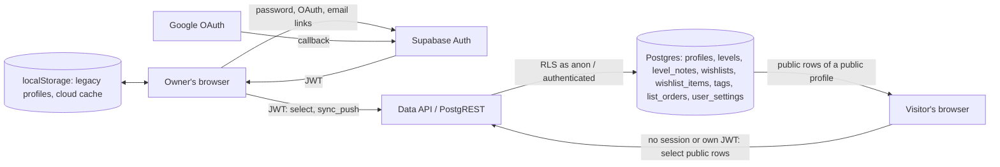

# Threat model: Supabase accounts

- **Date:** 2026-11-11
- **Scope:** issues #192-#198. Supabase Auth (Google and email/password), per-user cloud tables protected by Row Level Security, the sync function the app writes through, the one-time move of localStorage profiles into an account, and read-only public profiles opened by username. Out of scope: the level relay (`relay/`), the AREDL and community-sheet lookups, and Supabase's own infrastructure.

## Elements

| Assets | Actors | Entry points | Trust boundaries |
|---|---|---|---|
| Each user's progress: levels, attempts, times, deaths, notes, wishlists, tags, ordering | Account owner | Supabase Auth endpoints: sign-up, password sign-in, Google OAuth, recovery, email verification, token refresh | Browser → Supabase API: the client is untrusted, and anyone can call the API with the publishable key |
| Account identity: email address, password (held by Supabase Auth), session tokens in localStorage | Another signed-in user, curious or malicious | Data API (PostgREST) on every table in `public`, called with the user's JWT or with no session | Data API → Postgres: RLS policies and grants are the authorization boundary |
| Integrity of a public profile: only its owner may change it | Anonymous visitor of a public profile | The sync function (`sync_push`) and the other RPCs | Another user's content rendered in the viewer's browser (cross-user XSS) |
| Local progress that has not been moved yet (`localStorage.gdp`) | Bot that signs up in bulk or sends email in bulk | URL parameters: `?user=`, `?code=`, `?token_hash=&type=`, `?beta=`, auth error fragments | Email inbox → app: one-time links carry the proof of identity |
| Free-plan quota: 500 MB database, egress, auth emails | Someone with access to a shared device | Local data moved into the cloud during the migration | Google → Supabase Auth: the OAuth callback |

## Data flow

## Threats

| # | STRIDE | Threat | Likelihood | Impact | Existing control | Gap | Mitigation | Verification |
|---|---|---|---|---|---|---|---|---|
| 1 | I, E | A signed-in user reads or writes another user's rows through the Data API, for example `levels?user_id=eq.<other>` | High: the API is public, the key is public | High | None yet (rule 10 control 6) | No tables yet | RLS on every table with default deny; owner policies `user_id = (select auth.uid())` for select, insert, update and delete; `user_id` defaults to `auth.uid()` and every `with check` repeats the owner test | Integration test with users A and B and an anonymous client: A gets no rows of B and cannot insert, update or delete them on any table |
| 2 | T | Mass assignment through the sync function or a direct write: the client sends `user_id`, `version` or `updated_at` it chose | Medium | High | None yet | The client controls the whole row | `sync_push` is `SECURITY INVOKER`, so RLS still applies inside it; it writes `user_id` from `auth.uid()`; `version` and `updated_at` are set by triggers on every write path, never taken from the client | Test: A pushes a row carrying B's `user_id` and version 99; the row is stored for A with the version the server assigned, and B's rows are unchanged |
| 3 | I | A public profile leaks private data: personal notes, the email address or auth details | Medium | Medium | None yet | One level row would mix public fields and notes | Notes live in their own owner-only table `level_notes`; the email stays in `auth.users`, which the Data API does not expose; public read access is granted per table only to rows of profiles with `is_public`, through RLS, with no `SECURITY DEFINER` view or function | Test: an anonymous client reading a public profile gets its levels and no `level_notes` rows; a private or unknown username gives the same empty result |
| 4 | I | A new account is public before its owner decides | Low | Medium | None yet | No column yet | `profiles.is_public` defaults to `false`; a profile can be public only when it has a username (check constraint) | Test: a new account cannot be read anonymously |
| 5 | S, E | Stored XSS: another user's display name, username, biography, level, tag or wishlist names, tag colours or video link run script in the viewer's page and steal the session token from localStorage | Medium: public profiles render other people's text | High: account takeover | Templates escape text with `escapeHtml`; colours pass `isHexColor`; links pass `safeUrl`; CSP `script-src 'self'` blocks inline scripts and event handlers (rule 10 control 7) | Data can now come from someone else's account, and `style-src` keeps `'unsafe-inline'` | Check constraints validate every column (hex colours, `http(s)` links, numeric level IDs, lengths, allowed difficulties and statuses); the app cleans cloud and public data with the same rules it applies to imported files before drawing it | Database tests reject invalid colours, `javascript:` links and over-long names; a render test draws a public profile full of `` and `"` payloads and finds them escaped |
| 6 | S | Session tokens or one-time codes leak through the URL, the history or the referrer | Low | High | `Referrer-Policy: strict-origin-when-cross-origin`; Supabase codes are single-use; PKCE codes need the verifier kept by the browser that started the flow | Codes stay in the address bar after sign-in | Remove `code`, `token_hash`, `type` and auth error parameters with `history.replaceState` as soon as they are used | Browser check: after an OAuth or email-link sign-in the URL has no auth parameters |
| 7 | S | Password guessing or credential stuffing against email/password accounts | Medium | High | Supabase Auth rate limits per IP (rule 10 control 5) | Default minimum password length is 6 | `supabase/config.toml`: minimum length 8 with letters and digits required, email confirmation required, secure password change | Sign-up with `abc12` fails on the local stack; the auth rate limit is triggered once on the local stack and documented |
| 8 | S | An OAuth or email link redirects the user's tokens to an attacker's site | Low | High | Supabase only redirects to the allow list | The allow list does not exist yet | Site URL = the GitHub Pages URL; additional redirect URLs only `http://127.0.0.1:*/**` and `http://localhost:*/**` for development | `config push` dry run shows the list; sign-in with a `redirectTo` outside the list falls back to the site URL |
| 9 | D | One account fills the free database or churns it with endless writes | Low | Medium: the project is shared by every user | None yet | Supabase's free plan has no per-account limit on the Data API | Size limits in check constraints (names, notes, deaths, order arrays); per-user row caps (5,000 levels, 50,000 level tags, 200 wishlists, 5,000 wishlist entries, 300 tags) enforced by triggers on every write path; a per-account write budget of 50,000 written rows per minute, charged by statement triggers on every table; the deleted-row archive keeps at most 60,000 rows per account; `sync_push` rejects batches over 500 changes | Tests: the 5,001st level, the 50,001st level tag, a 501-change batch and the 50,001st row written in one minute are rejected |
| 10 | D | Sign-up or recovery requests used to bomb a victim's inbox | Medium | Low | Supabase limits emails per hour and per address | A custom SMTP will raise the hourly limit | Keep `auth.rate_limit.email_sent` low (30 per hour) when the custom SMTP is configured; CAPTCHA stays an option if abuse appears | Local stack: a second recovery email to the same address within a minute is refused |
| 11 | T | Two devices overwrite each other's newer data | High: normal use across a phone and a computer | Medium | None yet | localStorage has no versions | Every row has a server-assigned `version`; `sync_push` applies a change only when the version the client last saw still matches and returns the current row otherwise; the client merges field by field and tells the user which entries changed on another device | Test: a push with a stale version is reported as a conflict and leaves the row unchanged |
| 12 | I, T | On a shared device, the next person sees or edits the previous account's cached data | Medium | Medium | Today all local profiles are visible to anyone using the browser | The cloud cache will hold another account's data | The cloud cache is keyed by user ID and deleted on sign-out; signing in as a different user discards a cache that belongs to someone else; sign-out warns when changes are still waiting to be sent | Test: sign out, sign in as B, the cache of A is gone and none of A's levels render |
| 13 | T | Moving local data into an account loses data, duplicates it on retry, or overwrites cloud data | Medium | High | Local data is validated by `isValidProfileData` and cleaned by `ensureProfileDefaults` | No migration exists | The legacy store is never deleted automatically; the move writes through `sync_push` with the original IDs, so a retry cannot duplicate; an account that already has data asks before adding to it; the profile records when its local data was moved | Tests: running the move twice leaves one copy; a failed push keeps `localStorage.gdp` unchanged |
| 14 | E | A `SECURITY DEFINER` function runs with owner rights and is abused or hijacked through `search_path` | Low | High | None yet | The new-user trigger and account deletion need owner rights | Definer functions only where owner rights are required (`handle_new_user` in the unexposed `private` schema; `delete_account` limited to `auth.uid()`), all with `set search_path = ''` and schema-qualified names; `execute` revoked from `public` and `anon` | Supabase security advisors show no `function_search_path_mutable` or RLS warnings; a test calls `delete_account` as A and B's data is untouched |
| 15 | I | A secret key reaches the repository or the published site | Low | High | gitleaks runs on every pull request (rule 10 control 1) | New Supabase configuration is coming | Only the project URL and the `sb_publishable_` key are in `js/config.js`; the secret and service-role keys are never used by the app; CI uses the local stack's throwaway keys | Test: no tracked file contains `sb_secret_` or a JWT with `"role":"service_role"`; gitleaks is clean |

## Open mitigations

- [ ] RLS owner policies on every table, default deny — verified by the A/B/anonymous integration test (#193)
- [ ] Server-assigned `user_id`, `version` and `updated_at` — verified by the mass-assignment test (#193, #195)
- [x] Notes in `level_notes`, public rows through RLS only — verified by the anonymous public-profile test (#193, #197; `tests/db/public.test.js`)
- [x] Private by default, public only with a username — verified by the new-account test (#193, #197; `tests/db/public.test.js`)
- [ ] Column check constraints and client cleaning of cloud data — verified by the constraint tests and the hostile render test (#193, #197)
- [ ] Auth parameters removed from the URL — verified in the browser (#194)
- [ ] Password policy, email confirmation and redirect allow list in `supabase/config.toml` — verified on the local stack (#193, #194)
- [ ] Row caps, write budget and batch limit — verified by the limit tests (#193, #195)
- [ ] Versioned writes and field-level merge — verified by the stale-version test (#195)
- [ ] Per-user cloud cache cleared on sign-out — verified by the shared-device test (#195)
- [ ] Idempotent, non-destructive migration — verified by the double-run and failed-push tests (#196)
- [ ] Definer functions locked down — verified by the advisors and the `delete_account` test (#193, #194)
- [ ] No secret keys in the repository — verified by the key scan test and gitleaks (#193)

## Accepted risks

- **Reads are not rate limited per account.** The free plan has no limit on the Data API, and a read flood would also come from the anonymous role, which no per-account counter can see. Writes are bounded by the row caps and the write budget; Supabase usage alerts reveal abuse.
- **Usernames can be squatted or impersonate someone.** Names are first come, first served; renaming is allowed and breaks old links, and the profile editor warns about it.
- **Local development redirect URLs stay on the allow list.** A stolen PKCE code is useless without the verifier, and redirecting to the victim's own loopback address needs a program already running on their machine.
- **Clickjacking of account actions.** GitHub Pages cannot send `frame-ancestors` (browsers ignore it in a CSP meta tag), but browsers partition storage for third-party frames, so a framed copy of the app has no session.
- **Leaked-password protection is off.** Supabase checks passwords against HaveIBeenPwned only on the Pro plan. The free project requires 8 characters with letters and digits, and Google sign-in avoids passwords altogether.
- **No multi-factor authentication.** The app has no screen to enroll a second factor, so TOTP enrollment is turned off rather than left reachable through the API, where a stolen session could enroll a factor and lock the owner out.
- **A signed-in user's data is cached in localStorage** until they sign out, so the app opens offline. Another account signing in on the same browser deletes it; a session that expires on its own keeps it, so unsent changes are not lost.
- **Anyone who opens the browser has the local legacy profiles,** exactly as before accounts existed; the move into an account does not widen that.
